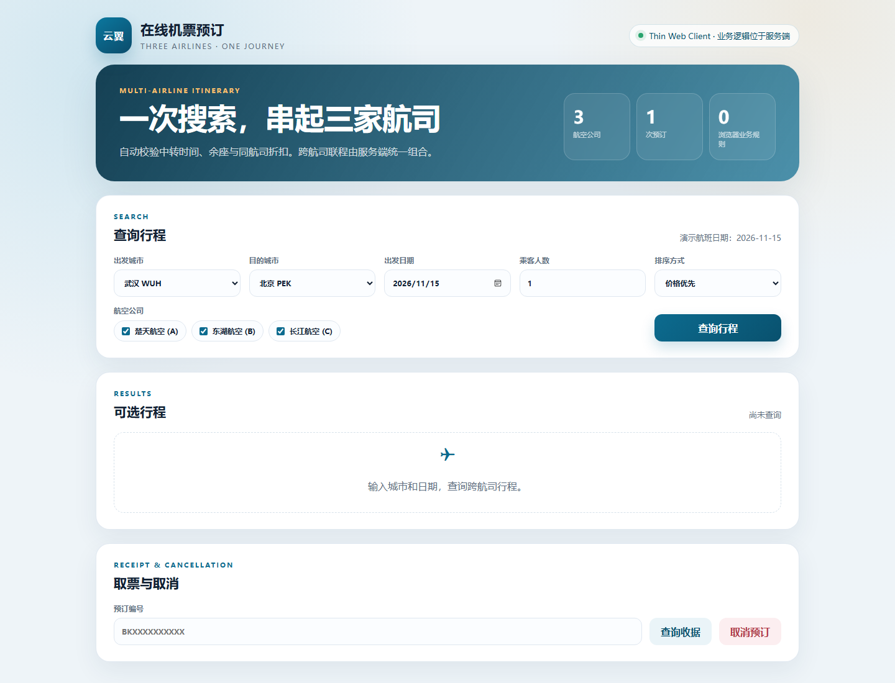
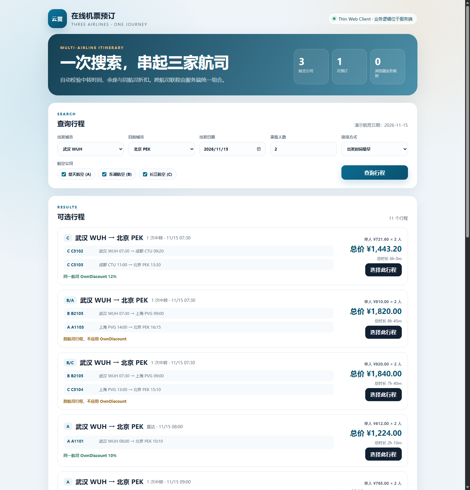
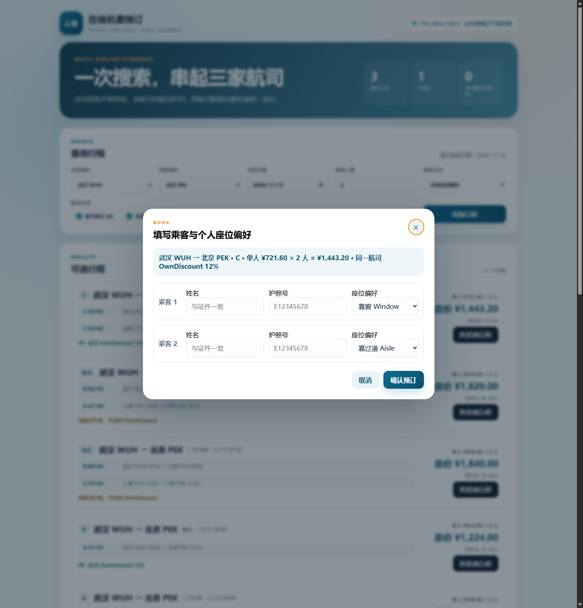
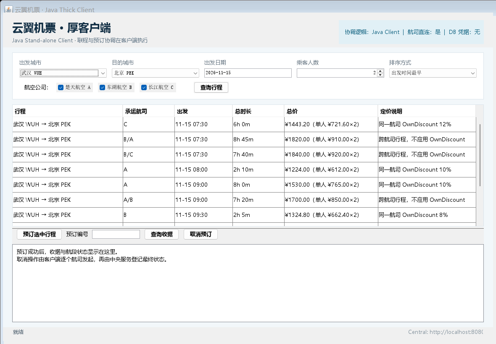

# 在线机票预订系统：Thin 与 Thick Client 双架构实现

软件体系结构（双语）第二部分团队实验的实现工程。同一套业务规则分别运行于：

- **V1 Thin Web Client**：浏览器只做展示和输入，联程组合、中转、余座、折扣、预订与取消协调全部在 Central Server。
- **V2 Java Thick Client**：Swing 桌面客户端执行联程组合和预订/取消协调，直接调用航司服务；Central Server 保留航司配置、公共数据、收据登记和审计边界。

当前交互支持：

- 排序：价格优先、总时长优先、出发时间最早。
- 多人行程同时显示“单人价 × 人数 = 总价”。
- 每位乘客独立选择靠窗、过道或中间座位偏好。



查询结果中的机场统一显示为“中文城市名 + 三字码”：



每位乘客独立填写座位偏好：



## 1. 运行环境

- JDK 17+（本机已在 JDK 25 上构建和运行）
- Maven 3.9+
- 真实数据库：MySQL 8.x（默认端口 3308）+ Oracle 23ai/19c（`FREEPDB1`）
- H2 演示模式：不需要外部数据库，每个进程使用独立 H2 数据库

## 2. 快速启动（H2 开发环境）

```bash
bash scripts/start-all.sh
```

启动后：

- Thin Web Client：<http://localhost:8080>
- Central Server：<http://localhost:8080/health>
- Airline A：<http://localhost:8081/health>
- Airline B：<http://localhost:8082/health>
- Airline C：<http://localhost:8083/health>

演示数据固定为 **2026-11-15**，推荐查询：

```text
WUH → PEK，2 人，价格优先
```

结果中同时包含直达、同航司联程和跨航司联程，例如：

- `B2102 → A1104`：武汉—广州—北京，跨航司，无 OwnDiscount
- `B2105 → A1103`：武汉—上海—北京，跨航司，无 OwnDiscount
- `C3101`：长江航空直达，应用 12% OwnDiscount

停止服务：

```bash
bash scripts/stop-all.sh
```

## 3. 启动 Java 厚客户端

先启动四个服务，再运行：

```bash
bash scripts/run-thick-client.sh
```

如果中央服务不在默认地址：

```bash
CENTRAL_URL=http://localhost:8080 bash scripts/run-thick-client.sh
```

厚客户端标题栏明确显示：`协调逻辑：Java Client | 航司直连：是 | DB 凭据：无`。客户端通过 Central Server 获取航司注册信息，但航司查询、预占、确认和取消请求由客户端直接发往航司服务。



## 4. 模块结构

```text
domain-model      实体、DTO、状态枚举，不依赖框架
domain-core       TripComposer / BookingCoordinator；V1 服务端与 V2 客户端共用
airline-client    航司 HTTP 契约实现，不依赖 Spring
airline-server    航司服务：查询、预占、确认、取消、过期释放、独立数据库
central-server    V1 业务协调、收据持久化、航司和机场配置、静态页面托管
thin-web          浏览器静态资源，不依赖 domain-core
thick-client      Swing 客户端，直接调用航司服务并执行 V2 协调
```

## 5. 核心接口

| 方法 | 路径 | 说明 |
|---|---|---|
| POST | `/api/search` | V1 查询与联程组合 |
| POST | `/api/bookings` | V1 预订，请求含 `idempotencyKey` |
| GET | `/api/bookings/{ref}` | 查询收据 |
| POST | `/api/bookings/{ref}/cancel` | V1 取消协调 |
| POST | `/api/bookings/register` | V2 客户登记已由客户端确认的预订 |
| POST | `/api/bookings/{ref}/mark-cancelled` | V2 客户登记最终取消状态 |
| GET | `/api/airlines` | 航司注册和客户端可直连地址 |
| GET | `/api/airports` | 机场最短中转时间 |
| GET | `/{airline}/flights` | 航司航班查询 |
| POST | `/{airline}/holds` | 预占座位 |
| POST | `/holds/{id}/confirm` | 确认预占 |
| DELETE | `/holds/{id}` | 释放预占 |
| GET | `/reservations/{ref}` | 查询航司预订状态 |
| GET | `/reservations/{ref}/details` | 查询权威航段与票价明细 |
| POST | `/reservations/{ref}/cancel` | 航司取消与回补 |

完整路径前缀为 `/api/airline/{code}`。

## 6. 真实数据库启动

已配置连接：

```text
MySQL   127.0.0.1:3308   airline_a / airline_b / airline_central
Oracle  localhost:1521/FREEPDB1   airline_c
中央库  MySQL: airline_central
```

新机器首次配置建库、账号、端口和 Oracle PDB，见
[`docs/real-database-setup.md`](docs/real-database-setup.md)。

密码不写入仓库。直接运行脚本，脚本会用隐藏输入提示密码：

```bash
bash scripts/start-real-db.sh
```

也可以在启动前通过 `DB_PASSWORD` 环境变量传入。脚本默认把航司服务放在 `18081/18082/18083`，中央服务放在 `8080`，避免与机器上其他 Java 进程冲突；可用 `AIRLINE_PORT_A/B/C`、`CENTRAL_PORT` 覆盖。

- MySQL 和中央库每次启动执行 `schema-*.sql`，脚本使用 `CREATE TABLE IF NOT EXISTS`。
- Oracle 表已存在时默认不再执行建库脚本。空 Oracle 库首次启动需要：
  `ORACLE_SCHEMA_INIT=true bash scripts/start-real-db.sh`；第二次启动必须去掉该变量。
- 航司服务启动时会把已有航班记录的 `airline_name` 和 `own_discount` 校正为当前配置，避免旧演示数据造成搜索价和收据折扣不一致。

数据库脚本：

- 航司 A/B：`database/mysql/schema-airline-mysql.sql`
- 航司 C：`database/oracle/schema-airline-oracle.sql`
- 中央 MySQL：`database/mysql/schema-central-mysql.sql`
- 中央 Oracle：`database/oracle/schema-central-oracle.sql`
- 账号模板：`database/mysql/create-accounts.sql`、`database/oracle/create-accounts.sql`

跨航司预订采用 Saga/补偿：逐航司预占，任一失败逆序释放；全部成功后确认并生成收据。数据库提交不是全局 ACID，超时预占由航司服务定时释放。

## 7. 验证

```bash
# 规则单元测试
mvn -f pom.xml test

# V1 完整流程：查询、跨航司预订、幂等、查收据、取消、库存回补
python3 scripts/smoke_test.py

# V2 Java 厚客户端：客户端组合行程、直连航司预占、中央登记、客户端取消
bash scripts/run-thick-smoke.sh

# 并发抢最后余座，验证不超售并回补
python3 scripts/concurrency_test.py

# 架构边界静态检查
python3 scripts/architecture_check.py
```

已实际执行并通过（真实数据库）：

- MySQL：A/B 航司库和中央库，端口 3308；Oracle：C 航司库，`FREEPDB1`。
- `domain-core`：9 个规则测试通过（5 个行程组合 + 4 个预订校验）。
- V1 冒烟：跨航司 `B2102 → A1104` 两人预订成功，票价按“单人 ¥850.00 × 2 人”计算为 `1700.00`，每位乘客分别保存 `AISLE` / `WINDOW`，重复提交返回同一 `bookingReference`，扣座 `[4,6] → [2,4]`，取消后回补 `[4,6]`。
- V2 Java 厚客户端冒烟：客户端组合 `BB2102 → AA1104`，直连航司确认，中央按航司权威明细登记 `CONFIRMED`，保留 `WINDOW` / `AISLE` 两种乘客偏好，客户端协调取消 `CANCELLED`。
- 排序：`DEPARTURE` 返回按首段出发时间升序，首条 `07:30`。
- 预订前重新读取航司航班，校验航段连续、最短中转、人数和航班归属。
- 幂等：同 key 重试返回同一收据；同 key 改内容返回 `IDEMPOTENCY_CONFLICT`；并发同 key 只有一条进入执行。
- 过期预占确认返回 `HOLD_EXPIRED`；`CANCEL_PENDING` 由中央后台任务自动重试收口。
- 并发抢座：两名乘客同时对 C3101 发起 2 人预订，1 成功、1 返回 `SEATS_UNAVAILABLE`，取消后余座恢复为 3。
- 账号隔离：`airline_a` 连接 `airline_b` 被 MySQL 以 `Access denied` 拒绝。
- 持久化：中央服务重启后，MySQL 中的既有收据仍可查询。
- Thin Web：Edge 实际渲染正常，静态资源与 API 同源可访问。

完整记录见 [`docs/verification.md`](docs/verification.md)。

## 8. 明确未完成 / 限制

1. Oracle 库中的表在本轮联调前已经存在；空库建表仍需按 `docs/real-database-setup.md` 首次初始化。
2. 未实现真实支付、出票、退票费用、代码共享、复杂运价和第三方航司接口。
3. 未实现用户注册、JWT/SSO 和权限系统；知道预订编号仍可查询/取消，公网部署前必须补授权。
4. 演示数据只有 `2026-11-15` 一天，其他日期会返回空结果。
5. 预订失败后的补偿会立即重试 3 次，但还没有独立的持久化补偿队列；连续失败时仍需要人工或后续任务对账。
6. 幂等占位表按单实例设计；多实例部署还需要数据库行锁或分布式锁。
7. Swing 界面已编译，V2 业务通过无界面 smoke 类验证；尚未做人工视觉验收和 GUI 自动化测试。
