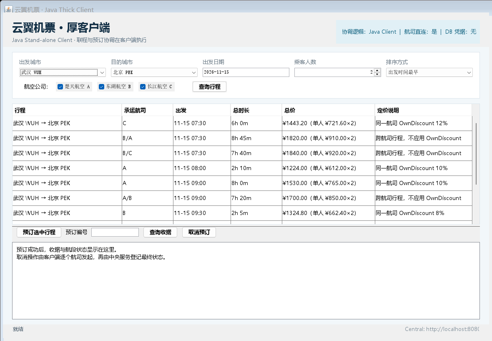
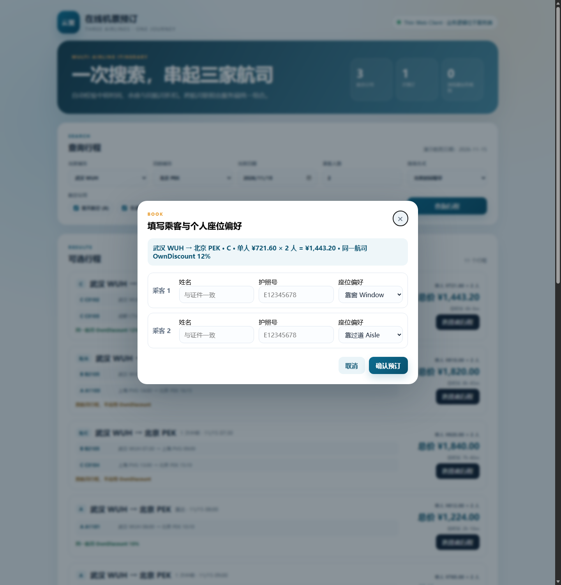
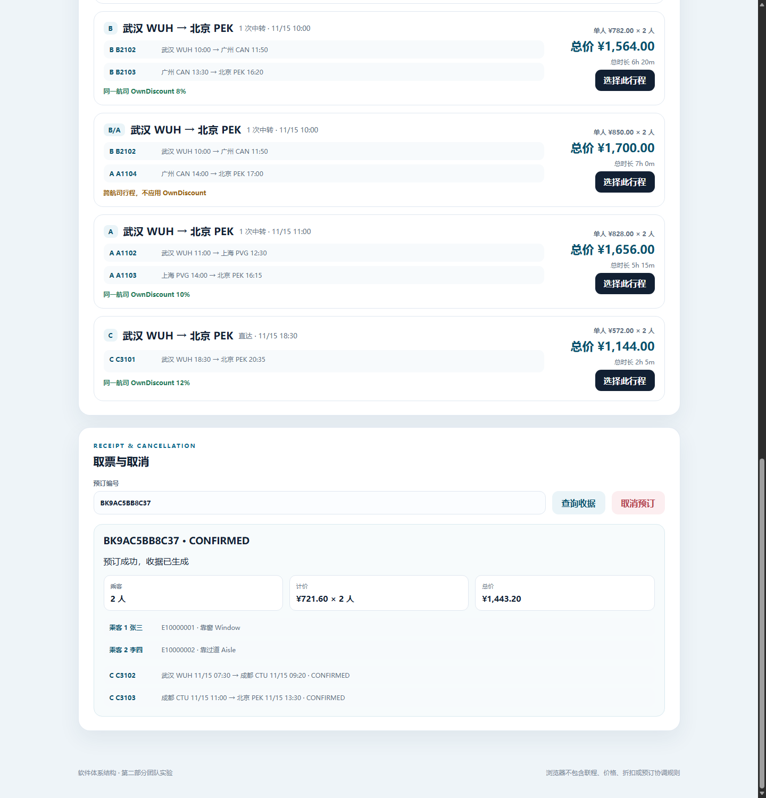
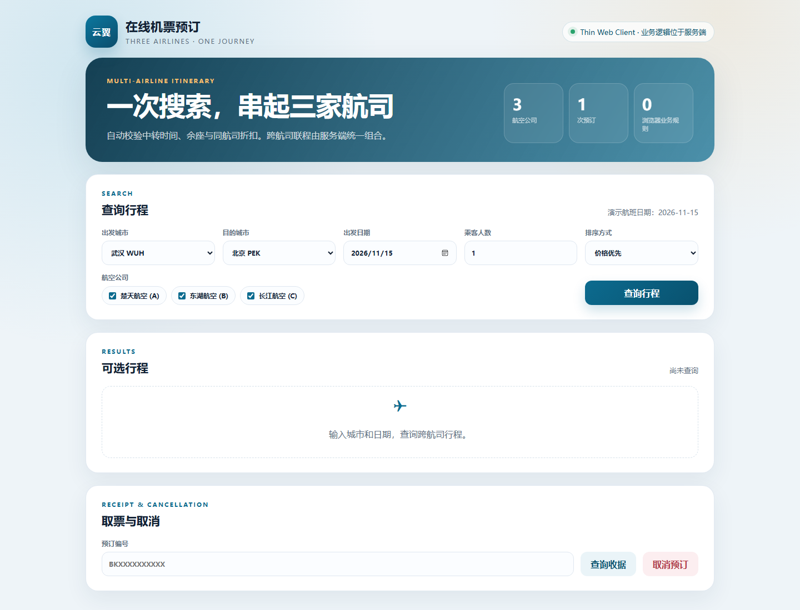
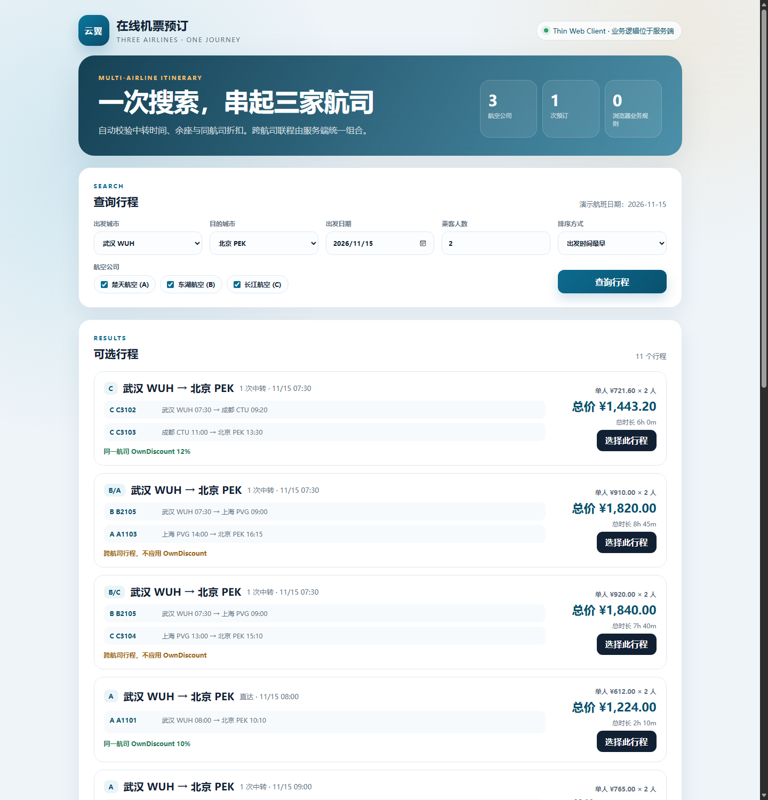

# 实现验证记录

日期：2026-11-01（最后更新：2026-11-03）

环境：Windows 11，JDK 25，Maven 3.9.6

运行模式：真实 MySQL + Oracle；2026-11-03 Oracle 容器恢复后完成最终回归。

## 1. 数据库环境

| 服务 | 数据库 | 连接 |
|---|---|---|
| 航司 A | MySQL 8.x | `127.0.0.1:3308/airline_a` |
| 航司 B | MySQL 8.x | `127.0.0.1:3308/airline_b` |
| 航司 C | Oracle 23ai Free | `localhost:1521/FREEPDB1` |
| Central | MySQL 8.x | `127.0.0.1:3308/airline_central` |

- MySQL A/B/Central 表由 `scripts/start-real-db.sh` 调用 `database/mysql/schema-*.sql` 创建。
- Oracle 表在本轮启动前已经存在，本轮通过应用查询、预占、扣座和取消验证其结构可用。
- 数据库密码只通过 `DB_PASSWORD` 环境变量传入；源码和构建产物中不包含明文密码。

## 2. 构建与单元测试

```bash
mvn -f pom.xml test
```

结果：`BUILD SUCCESS`，9 个领域规则测试全部通过：

- 直达与一跳联程组合
- `ConnectionTime` 小于最小值时拒绝
- `ConnectionTime` 刚好等于最小值时允许
- 跨航司不打折、人数乘票价、余座不足过滤
- 按首段出发时间最早排序
- 预订前校验权威航班、乘客人数、航段连续性和最短中转
- 拒绝人数不一致、非连续航段和过短中转

## 3. V1 Thin Web 全流程（真实 MySQL + Oracle）

```bash
python3 scripts/smoke_test.py
```

实际输出：

```text
跨航司行程: BB2102(WUH-CAN) -> AA1104(CAN-PEK)
预订前余座: [4, 6]
预订成功: BK07FFC59262 1700.0 CONFIRMED
幂等重试通过: BK07FFC59262
收据查询通过: BK07FFC59262 乘客偏好: ['AISLE', 'WINDOW']
扣座验证通过: [2, 4]
取消成功: CANCELLED 航段状态: ['CANCELLED', 'CANCELLED']
重复取消幂等通过
库存回补通过: [4, 6]
SMOKE_TEST_PASS
```

覆盖：跨航司联程、2 人计价、MySQL 预订表、Oracle 预订/库存更新、幂等提交、收据查询、取消和库存回补。

## 4. V2 Java Thick Client 全流程

```bash
mvn -f pom.xml -pl thick-client -am install -DskipTests
mvn -f pom.xml -pl thick-client exec:java \
  -Dexec.mainClass=com.example.airline.thick.ThickClientSmoke
```

实际输出：

```text
V2 client trip: BB2102 -> AA1104
V2 registered: BK1425C5A50C CONFIRMED 1700.00 seats=[WINDOW, AISLE]
V2 cancelled: BK1425C5A50C CANCELLED
THICK_CLIENT_SMOKE_PASS
```

覆盖：客户端侧联程组合、直连 MySQL/Oracle 航司服务预占/确认、中央按航司权威明细登记收据、客户端协调取消。

Swing 界面已实际启动并自动点击“查询行程”，结果表返回 11 个行程；搜索栏、结果表和收据区均显示“中文城市 + 三字码”，多人总价显示为“总价（单人 × 人数）”：



## 4.1 排序、多人价与逐人座位偏好

- `SortMode.DEPARTURE` 已验证：按首段出发时间升序，同为 07:30 时按总价升序；首条为 `2026-11-15T07:30:00`。
- 查询结果新增 `pricePerPassenger` 和 `passengers`。2 人示例：`单人 ¥721.60 × 2 人 = 总价 ¥1,443.20`。
- 每位乘客独立座位偏好：V1 实际入库为 `['AISLE', 'WINDOW']`；V2 为 `seats=[WINDOW, AISLE]`，均能在收据中还原。
- 旧收据没有逐人偏好记录时，回退到原订单级偏好，查询仍可正常返回。
- 薄客户端预订弹窗已验证两名乘客各有独立“座位偏好”下拉框：



- 通过 UI 实际提交两人订单 `BK9AC5BB8C37`，收据显示“单人 ¥721.60 × 2 人”、乘客 1 靠窗、乘客 2 过道；随后通过 API 取消成功。



- 出发时间排序由接口和 UI 双重验证：`sortMode=DEPARTURE` 时首段出发时间升序，首条 `2026-11-15T07:30:00`。

## 5. 并发扣座（Oracle 航司 C）

```bash
python3 scripts/concurrency_test.py
```

实际输出摘要：

```text
并发请求结果: 1 成功, 1 失败
失败响应: BOOKING_FAILED ... SEATS_UNAVAILABLE ...
C3101 余座回补: 3 -> 3
CONCURRENCY_TEST_PASS
```

说明：Oracle 航司在同一航班最后余座上执行了条件扣减，没有超售。

## 6. 账号隔离

用 `airline_a` 的凭据尝试连接 `airline_b`：

```text
java.sql.SQLSyntaxErrorException:
Access denied for user 'airline_a'@'127.0.0.1' to database 'airline_b'
```

说明：MySQL A/B 账号按 schema 隔离，A 不能越权访问 B 的数据。

## 7. 中央服务重启持久化

重启 Central Server 后查询既有收据 `BKA8F5809F86`：

```text
{'ref': 'BKA8F5809F86', 'status': 'CANCELLED', 'total': 1700.0, 'legs': 2}
```

说明：收据保存在 MySQL `airline_central`，不是进程内状态。

## 8. 启动脚本与架构边界

```bash
DB_PASSWORD=*** bash scripts/start-real-db.sh
python3 scripts/architecture_check.py
```

`start-real-db.sh` 成功启动四个服务并通过健康检查：

```text
Thin Web Client : http://localhost:8080
Airline A MySQL : http://localhost:18081/health
Airline B MySQL : http://localhost:18082/health
Airline C Oracle: http://localhost:18083/health
Central MySQL   : http://localhost:8080/health
```

架构检查结果：`ARCHITECTURE_CHECK_PASS`

- `thin-web` 不依赖 `domain-core`
- V1 由 `central-server` 执行共享规则和预订协调
- V2 由 `thick-client` 执行共享规则并调用航司服务
- 浏览器无中转时间和折扣计算

## 9. Web 渲染检查

使用 Edge headless 对 `http://localhost:8080` 进行 1440×1100 截图，页面完整渲染：



通过 Chrome DevTools Protocol 自动提交 `WUH → PEK` 查询，结果卡首条显示：

```text
武汉 WUH → 北京 PEK
C C3101  武汉 WUH 18:30 → 北京 PEK 20:35
```



## 10. 2026-11-03 修复回归

- `mvn test`：9/9 通过。
- V1：`BK07FFC59262`，2 人 `1700.00`，取消后座位回补。
- V2：`BK1425C5A50C`，`WINDOW/AISLE` 两种偏好被中央还原。
- 幂等：同 key 重试返回同一收据；同 key 改内容返回 `409 IDEMPOTENCY_CONFLICT`；并发同 key 一条成功、一条返回 `IDEMPOTENCY_IN_PROGRESS`。
- 预订校验：伪造乘客人数返回 `409 BOOKING_FAILED`，不会进入航司预占。
- 过期预占：0 分钟预占实例确认返回 `409 HOLD_EXPIRED`。
- 取消重试：人为制造 `AIRLINE_NOT_CANCELLED` 后中央进入 `CANCEL_PENDING`，30 秒后台任务收口为 `CANCELLED`。
- 前端：乘客人数改变后拒绝使用旧报价；不勾选任何航司时提示至少选择一家。
- Oracle 容器 `oracle23ai` 恢复后，C 已切回 `FREEPDB1`；V1/V2 最终回归均在真实 MySQL + Oracle 上通过。

## 11. 验证边界

1. Oracle 表在本轮之前已经存在，未从空 Oracle schema 重新执行 DDL；已通过应用读写验证。
2. 未覆盖真实支付、出票、退票费用、代码共享、第三方航司接口、用户认证与授权。
3. 演示数据固定为 `2026-11-15`，其他日期返回空结果。
4. Swing 界面已编译，V2 业务通过无界面 smoke 类验证；尚未做 UI 自动化。
5. 预订失败补偿只有 3 次即时重试，没有持久化补偿队列。
6. 幂等占位按单实例设计，多实例部署仍需数据库行锁或分布式锁。
